# 设备远程控制

Tkinter 桌面程序，通过 TCP 协议接收服务器事件并控制 PLC 完成打印流程和闪喷维护。

- 主程序：`device_control.py`
- 配置文件：`config.toml`（修改后重启生效，缺失或格式错误时使用内置默认值）

## 启动方式

- **日常使用，不显示控制台**：双击 `start-hidden.vbs`，仍由 `start.bat` 使用 uv 启动 GUI。关闭 GUI 后隐藏的启动进程自动结束。启动及控制台输出写入同目录的 `launcher.log`（每次启动覆盖）；非零退出码会弹窗提示查看日志。
- **查看控制台日志**：双击 `start.bat`，或使用 `start.ps1`。正常关闭 GUI 后不再等待按键，双击打开的控制台随启动脚本结束；异常退出时仍保留窗口等待确认，方便查看错误。
- 若从已有终端中运行脚本，脚本结束后会返回该终端，不会关闭你原本打开的终端。
- 如系统策略禁用了 Windows Script Host / VBScript，请使用 `start.bat`；隐藏启动不改变设备、通信或运动逻辑。

## 连接

连接地址和端口统一在 `config.toml` 配置，UI 仅提供“连接/断开”按钮。修改后需重启程序生效：

```toml
[PLC_server]
host = "192.168.1.88"
port = 2001

[printer_server]
host = "127.0.0.1"
port = 19090

[printer_listener]
host = "127.0.0.1"
port = 19091
```

- **`PLC_server`**：PLC/设备控制服务器连接，负责三轴运动控制以及设备状态上报。
- **`printer_server`**：Python 主动连接的 MFC 打印扫描服务器，负责打印流程事件，以及闪喷（`FLASH`）、压墨（`PRESS_INK`）等打印维护指令。
- **`printer_listener`**：Python 启动时自动监听的独立地址，接受 MFC 的反向连接。**MFC 当前固定连接 `127.0.0.1:19091`**，因此应保持此默认配置；单独修改 Python 端口不会同步修改 MFC。

### 打印服务双向连接与握手

Python 启动后同时保留原有主动连接 `19090` 的行为和 UI“连接/断开”按钮，并监听 `19091`。MFC 在没有已完成 HELLO 的 Python 连接时，每秒尝试一次反向连接，因此两个程序的启动顺序不限。两种连接共用同一个 `ScanClient` 命令/事件通道，任一时刻只保留一个活跃 socket：先成功安装的连接胜出，重复 incoming 直接关闭且不触发现有连接的断开回调；已有连接时主动连接不会再创建 socket。被动连接胜出时，尚在尝试的主动连接也会关闭。

协议均使用 ASCII 行，以 `\r\n` 结束：

1. MFC 把任一方向的连接加入通道时先发送 `NETSCAN_SERVER_READY\r\n`。
2. Python 安装连接后立即主动发送 `HELLO PLC\r\n`，**不等待 READY**。
3. MFC 收到 HELLO 后回复 `OK HELLO PLC\r\n`；初始 READY 已足够，不要求也不依赖再次发送 READY。
4. MFC 仅在启动任务时发送 `PING TOKEN=<正整数>\r\n`（token 递增，MFC 等待回包超时为 3 秒）。Python 在接收线程中通过原 socket 直接回复 `PONG TOKEN=<原token>\r\n`，不经过 UI/任务事件队列，也保留 token 的原始数字文本。**重置编码流程活跃时不回 PONG**，避免 MFC 同时获得打印启动权限；结束/取消后恢复。`ScanClient.can_start_job` 是可选的接收线程回调，缺省放行，主窗口只读取线程安全 Event，不调用 Tk，也不增加任何协议命令。

`OK HELLO PLC`、`PING`、`PONG` 是内部握手/心跳帧，不会作为任务事件派发；PING 不会触发任何运动。原有 `EVENT ...` 和命令回复沿用原回调，接收缓冲保留半行，完整分行后才派发。旧连接的接收线程只能关闭自己的 socket，不能影响重连后的新连接。

UI“断开”会断开当前打印通道、取消尚在尝试的主动连接，并**暂停接管反向连接**：监听 socket 保留，但 MFC 后台重试的 incoming 会被立即关闭，不发送 HELLO、不安装连接，也不额外触发断开回调，因此不会立刻自动连回。点击“连接”会恢复反向接管并尝试主动连接；即使本次主动连接失败，反向监听仍然可用。启动时默认允许反向连接；网络断开或接收失败不会暂停接管，MFC 可自动重连。这些变化仅影响连接管理，不改变运动状态机。

退出窗口时会关闭监听、当前连接及尚在尝试的主动连接。若监听端口被占用，日志会显示反向监听启动失败，原有主动连接仍可使用。

X 轴速度在 `config.toml` 的 `[auto_cycle]` 中配置，取值为 1~100 的正整数：`x_speed_outbound`（去程，起始位置→终点，默认 60）和 `x_speed_return`（来程，终点→起始位置，默认 90）。每个 PASS 开始去程或返回时，程序会先向 PLC 发送对应的 `V=速度` 指令。

- **设备**：TCP 直连，周期上报状态帧 `POS:X=+014.88,Y=+000.00,Z=+000.00,D=0,G=0`（X/Y/Z 位置、UV 灯、滚子状态）
- **扫描服务器**：`127.0.0.1:19090`，负责闪喷（`FLASH`）指令，回送 `OK ...` 结果

> **设备协议限制：Y 相对移动指令最多只能有两位小数。** `PASS_READY` 的 `STEP` 单位为 μm，程序先换算成 mm，再四舍五入到两位小数后发送。例如：`STEP=1714` → `Y+1.71`，`STEP=1715` → `Y+1.72`，`STEP=-1715` → `Y-1.72`。Y 的到位目标也必须使用舍入后的距离计算，不能使用原始的三位小数值。

## 重置编码（手动维护）

轴控制区三轴点动下方、预设按钮之前增加 **“重置编码”**。确认机械路径安全后点击一次，程序自动完成 **X 到配置的零点位置并确认停稳 → 向 MFC 发硬件复位指令 → 固定等待 2 秒 → X 回配置的起始位置**。目标分别来自 `config.toml` 的 `[auto_cycle].x_zero` 和 `x_home`，与界面“零点位置”/“起始位置”按钮相同，不写死为 `0` / `-5`。不使用打印“暂停/恢复”，不使用固定 sleep 判断到位；2 秒等待使用可取消的 UI 定时器，不阻塞界面。日志和状态栏显示完成/中止结果；只有返程到位且 END 成功回复后才算完成。

### 启动门禁与锁定

- PLC 必须连接，且当前 PLC socket 已收到过有效 POS；MFC 必须连接并收到 `NETSCAN_SERVER_READY`。此首次 POS **仅作连接门禁，不能用于本次运动到位判断**。
- 自动打印、任一轴 pending、未发送完的 PLC 队列、闪喷/压墨未完成、循环压墨或其他维护等待期间拒绝启动；X 配置行程必须同时包含 `x_zero` 和 `x_home`，否则不发送 BEGIN、不移动。
- 整个流程锁定 X/Y/Z、目标输入、点动步长、预设及设备相关参数/维护/自定义命令；重置按钮也加入 X 轴锁组，自动打印时不可按。**急停和事件区“停止”始终可用**，连接区可断开。主逻辑同样防止重入、手动运动和自定义命令覆盖目标。
- 自定义命令缺少可靠的完成语义：正常发送仍保留，但发送原始 PLC/扫描命令后，会保守阻止重置编码，需先点“停止”清理；不要通过自定义命令调用编码器协议。

### 严格顺序与协议

所有 MFC 消息使用 **ASCII + CRLF**、同一活跃 socket、一次流程一个正整数 TOKEN。TOKEN 单调递增且限制在 MFC 有符号 32 位 LONG 范围 `1..2147483647`，溢出在任何发送之前拒绝，不使用时间戳大整数：

1. Python 发 `ENCODER_RESET_BEGIN TOKEN=n`，只预约维护。必须收到 `OK ENCODER_RESET_BEGIN TOKEN=n` 才允许运动；MFC 预约期间禁止启动打印。ERR（如 `BUSY/STOPPING/NOT_READY`）则取消，不能移动。
2. Python 排队发送 PLC `X=<x_zero>`。只使用实际发送之后收到的**新 POS**确认停稳：至少连续 3 帧、覆盖至少 500 ms；零点误差及窗口内坐标变化均不超过 `0.01 mm`（零点误差还受 `POS_TOLERANCE` 限制）。收到离开范围或坐标不稳定的反馈会重新累计；帧超过 1 秒未更新或消息已陈旧也不能沿用稳定窗口。PLC 协议没有独立的“运动已停止”状态位，因此这是基于位置反馈的停稳判定；没有持续新 POS 就不会复位。初始化坐标、点击前缓存、发送前反馈、重复/反序/过期反馈均不能替代停稳确认。
3. Python 发 `RESET_ENCODER TOKEN=n`，MFC 按原协议执行 `DEV_ResetPrinterEncValue(ZERO_POSITION)`。**复位指令成功发送后，Python 从发送返回时刻起固定等待 2 秒，不等待 MFC 成功回复；已有 `OK RESET_ENCODER` 回复只兼容接收，不用于推进、不校验其中的 ENC，也不能缩短等待。** 未收到 OK 也会在 2 秒后继续。BEGIN/END 的预约/释放确认仍保留；若等待期间收到复位 ERR、发生断线、取消或停止则中止，不继续返程。
4. 等待满 2 秒且原连接仍有效后，发送 PLC `X=<x_home>`，同样等待实际发送之后的新 POS 到位（默认容差 `0.1 mm`），再发 `ENCODER_RESET_END TOKEN=n`；收到 `OK ENCODER_RESET_END TOKEN=n` 后完成解锁。**END ACK 超时同样按失败处理**。
5. 停止/断线/失败/超时会失活流程、撤销尚未发送的本次运动、取消定时器，并尽力用原 MFC socket 发 `ENCODER_RESET_CANCEL TOKEN=n`。MFC 幂等回复 `OK ENCODER_RESET_CANCEL TOKEN=n`；MFC socket 断开也会清除其预约。迟到/旧 TOKEN/旧 socket 的回包不触发移动。

运动阶段超时默认 **30 秒**（含零点停稳确认），BEGIN/END ACK 默认 **5 秒**；复位后为固定 **2 秒**等待，不是 RESET ACK 超时（`encoder_reset.py` 常量及构造参数；测试可注入 fake clock/调度器）。只有**本流程确实下发过 X 运动**（发送失败时可能已部分下发也保守计入）才因维护取消发送 `q`；BEGIN 拒绝/超时或尚未发送运动时不发 `q`，避免误停刚获得打印权限的任务。用户显式点击急停/停止仍保留原本立即 `q` 的含义。

### 同时点击 MFC 开始与重置

- 活跃维护通过 PING 门禁不再授予新的打印启动许可。
- PING 可能恰好先于本地 BEGIN 获得许可：如果 BEGIN **尚未成功**时收到 `EVENT START_JOB`，取消未动维护（不发 `q`），再交回原有 START_JOB 打印逻辑。
- BEGIN **已成功预约**后若仍收到 START_JOB，则视为协议/任务冲突：取消维护（自身已运动才 `q`）并拒绝该事件。维护期间其他打印事件同样不混入状态机或覆盖目标。

发送器改动只用于安全确认/撤销：维护队列项绑定 socket、取消 Event，发送锁内标记“自身运动已下发”，发送完成回调携带 monotonic 时间；POS 同样携带接收时间和 socket。队列入队本身不是发送 ACK。正常打印段/到位推进逻辑保持原有行为。

并发安全边界：

- **MFC 失效立即撤销 guard**：`ScanClient.on_channel_invalidated(socket)` 是纯 Python hook，在活跃通道锁内、清除 socket 之前调用，只在 PLC 发送锁内清除对应 Event；不等待 Tk 清理、不操作 Tk。guard 发布同样受通道锁保护。唯一跨锁顺序为 `ScanClient → TcpSender`，发送线程只检查 Event，不反取 ScanClient 锁。
- **取消只作用于原 PLC**：`cancel_guarded_motion` 在发送锁内核对 `expected_sock`，只有原 PLC 仍是当前连接且本流程已发送运动才 `q`；不调用通用急停、不清其他队列，已取消的自身项由发送线程丢弃。原 A 断开、B 重连后取消 A 流程不会 `q` B，也不会清 B 的队列；用户显式急停仍保持当前连接 `q` 并清队列的原语义。
- **POS/发送回调可反序**：运动阶段可暂存本阶段实际收到、接收时间最新的一个 POS 候选；发送完成回调到达后，仅重放 `received_at > sent_at` 的候选。阶段切换及中止立即清空，不能从 `positions` 缓存补到位，也不需要设备额外再上报一帧。
- **打印事件与编码器 ACK 分开判定**：可选 `on_channel_state(connected, message, socket)` 与 `on_channel_response` 在通道锁内只向 Python UI 队列投递；连接成功边界先于 recv 启动，完整事件先于断开边界。主线程用已消费的 socket 会话过滤打印事件，因此已收到的 `PRINT_JOB_COMPLETED` 紧跟 EOF 仍能结束任务；快速重连后旧事件不混入新任务，晚到旧 False 不覆盖新会话。编码器 ACK 仍额外要求原 socket **实时有效且 ready**，不能靠旧会话中排队的成功回包恢复运动。未提供可选回调时仍兼容原两参连接回调。

除上述同步撤销 Event 外，网络线程只向 Python 队列写回调；全部 Tk 更新、状态机推进和定时器清理由主线程处理。

> 网络故障时 `q`/CANCEL 都只能尽力发送，不能替代硬件急停。取消不代表机械已回零或编码已恢复；检查实际坐标和设备状态后再重试。固定 2 秒从 Python 发完复位指令起计算，不是硬件执行完成证明，也没有验证编码器实际读数。若 CANCEL 未送达且 MFC 仍占用预约，可断开 MFC 通道释放；不要绕过门禁强行打印。

## 服务器驱动打印流程

客户端仅运行服务器事件驱动流程，不再提供或执行手动打印自动循环。

<!-- 手动自动循环流程已移除，以下历史内容仅保留兼容说明
    LOCK --> PREHOME[prehome: X 移动到起始位置 X_HOME]
    LOCK --> LISTEN[等待服务器广播 LAYER_START LAYER=1]

    PREHOME --> END[向终点运动: X = X_END<br/>X >= UV距离 时开启自动UV灯]
    LISTEN --> END

    END --> CHK{X 到达终点}
    CHK --> CNT[计数: 闪喷计数+1]
    CNT --> ZC{打印层数达到 layers 倍数}
    ZC -- 是 --> ZDOWN[Z 下降 step 0.5mm, 计数清零]
    ZDOWN --> FC{启用维护闪喷 且 闪喷计数 ≥ 间隔}
    ZC -- 否 --> FC
    FC -- 否 --> HOME[向起点运动: X = X_HOME]

    FC -- 是, 闪喷计数清零 --> FON[发送 FLASH 开启闪喷]
    FON --> WAIT2[等待 pause_ms 2s]
    WAIT2 --> FCHK{闪喷仍开启?}
    FCHK -- 是 --> FOFF[发送 FLASH 关闭, 等待回送确认/超时]
    FOFF --> HOME
    FCHK -- 否 --> HOME

    HOME --> HCHK{X 到达起点}
    HCHK --> DC{内循环剩余 > 0?}
    DC -- 是 --> Y0{Y步进 = 0?}
    Y0 -- 是 --> END
    YSTEP --> END

    DC -- 否, 本组完成 --> OC{大循环剩余 > 1?}
    OC -- 是 --> YBACK[Y 回到起始位置, 大循环剩余-1,<br/>重置内循环次数]
    YBACK --> END
    OC -- 否 --> DONE[全部完成: 播放完成音效, 解锁]
    DONE --> FIN([结束])
-->

### 服务器驱动任务流程（EVENT START_JOB）

服务端广播 `EVENT START_JOB TOTAL_LAYERS=<总层数>` 启动打印任务，`TOTAL_LAYERS` 是扫描打印根目录得到的连续编号子文件夹数量；随后广播 `LAYER_START` / `PASS_READY` 等事件。全部图层正常打印完成时，服务端广播 `EVENT PRINT_JOB_COMPLETED TOTAL_LAYERS=<总层数>`，客户端仅以该事件作为打印完成和任务结束依据。程序用独立的 `_start_job()` 逻辑处理，不复用手动「开始」逻辑。收到 `START_JOB` 时界面打印进度初始化为 `0/<总层数>`，收到 `LAYER_START LAYER=<当前层>` 后更新为 `<当前层>/<总层数>`。

```mermaid
flowchart TD
    EV([服务器广播 EVENT START_JOB<br/>TOTAL_LAYERS=总层数]) --> AL{已在自动循环?}
    AL -- 是 --> IGN[忽略重复 START_JOB]
    AL -- 否 --> LOCK
    subgraph LOCK_ACTIONS[ ]
        direction LR
        LOCK[锁定 X/Y/Z 三轴] --> PY[记录当前 Y 位置为 Y 初始位置]
    end
    LOCK --> PREHOME[prehome: 移动 X 到起始位置 X_HOME]
    PREHOME --> LISTEN[/持续监听 LAYER_START<br/>更新当前层直到 TOTAL_LAYERS/]
    LISTEN --> CONSUME[收到任意合法层时从事件队列移除<br/>LAYER_START LAYER=n]
    CONSUME --> ZCOUNT{打印层数达到<br/>z_step.layers 的倍数?}
    ZCOUNT -- 是 --> ZSTEP[Z 下降 z_step.step]
    ZSTEP --> ZWAIT[等待 Z 到位]
    ZWAIT --> YHOME[移动 Y 到任务开始时记录的 Y 初始位置]
    ZCOUNT -- 否 --> YHOME
    YHOME --> YHOME_WAIT[等待 Y 到位]
    YHOME_WAIT --> WAIT_PASS[/循环等待 EVENT PASS_READY/]
    WAIT_PASS --> PASS_EVENT[从事件队列移除 PASS_READY<br/>CURRENT / TOTAL / STEP / EMPTY]
    PASS_EVENT --> PASS_UI[显示 PASS 进度 CURRENT/TOTAL]
    PASS_UI --> EMPTY{EMPTY = 1?}
    EMPTY -- 是，跳过Y/X运动 --> XHOME
    EMPTY -- 否 --> YSTEP[解析 STEP: μm ÷ 1000 = mm<br/>四舍五入到两位小数后移动 Y]
    YSTEP --> YWAIT[等待 Y 移动到位]
    YWAIT --> UVMODE{自动UV灯已开启?}
    UVMODE -- 否 --> END[使用 config.toml 的 x_end<br/>向 X 终点运动]
    UVMODE -- 是 --> UVEND[使用 config.toml 的 x_end_withuv<br/>向 X 终点运动]
    UVEND --> UVON{X ≥ uv_offset?}
    UVON -- 是 --> LAMPON[开启 UV 灯]
    UVON -- 否 --> UVON
    END --> ZERO[X 到达 x_end 即视为 PASS 完成<br/>不等待 PASS_REMAINING_ZERO]
    LAMPON --> UVARRIVE[等待 X 到达 x_end_withuv]
    UVARRIVE --> ZERO_UV[终点保持 UV 开启，PASS 运动完成<br/>不发送急停]
    ZERO_UV --> COUNT
    ZERO --> COUNT[闪喷计数 +1<br/>界面显示计数]
    COUNT --> FLASH_DUE{启用维护闪喷 且<br/>闪喷计数 ≥ flash.interval?}
    FLASH_DUE -- 是 --> FLASH_RESET[执行维护闪喷<br/>闪喷计数清零]
    FLASH_RESET --> XOFFSET[X 正向偏移 flash.x_offset]
    XOFFSET --> XOFFSET_WAIT[等待 X 到位]
    XOFFSET_WAIT --> STOP_WAIT[按 config.toml 配置等待]
    FLASH_DUE -- 否 --> STOP_WAIT
    STOP_WAIT --> XHOME[移动 X 到起始位置 X_HOME]
    XHOME --> XHOME_WAIT[等待 X 到位<br/>自动UV: 回程 X 小于 uv_offset 时关灯]
    XHOME_WAIT --> PASS_DONE{CURRENT < TOTAL?}
    PASS_DONE -- 是 --> WAIT_PASS
    PASS_DONE -- 否 --> LISTEN
    COMPLETE_EVENT([服务器广播 EVENT PRINT_JOB_COMPLETED<br/>TOTAL_LAYERS=本次任务总层数]) --> CLEAR_JOB[结束全部流程<br/>打印/PASS进度归零<br/>清空记录的 Y 初始位置]
    CLEAR_JOB --> FIN([结束])
    classDef yInitial fill:#fff3cd,stroke:#f59e0b,stroke-width:3px,color:#7c2d12,font-weight:bold
    classDef emergency fill:#fee2e2,stroke:#dc2626,stroke-width:3px,color:#7f1d1d,font-weight:bold
    classDef zStep fill:#dcfce7,stroke:#16a34a,stroke-width:3px,color:#14532d,font-weight:bold
    class PY yInitial
    class ZCOUNT,ZSTEP,ZWAIT zStep
    class FLASH_DUE,FLASH_RESET,XOFFSET,XOFFSET_WAIT zStep
    class PREHOME emergency
    class YHOME yInitial
    style LOCK_ACTIONS fill:none,stroke:none
```



> 说明：`START_JOB` 中的 `TOTAL_LAYERS` 记录为任务总层数，层进度初始化为 `0/TOTAL_LAYERS`。收到 `EVENT PRINT_JOB_COMPLETED TOTAL_LAYERS=n` 后，无论事件中的层数是否与当前任务记录一致，只要当前存在服务器自动任务即直接结束全部流程，不显示客户端弹窗。

> 每个合法图层开始时，程序根据当前打印层数判断是否达到 `[z_step].layers` 的倍数。达到时按 `[z_step].step` 控制 Z 下降并等待 Z 到位，然后才让 Y 回到任务初始位置；未达到倍数则直接执行 Y 回初始位置。若 Z 目标超出配置行程，自动流程中止。

设备周期上报的 `POS:X=...,Y=...,Z=...,D=...,G=...` 状态帧仍用于刷新坐标、开关状态和运动到位判断，但不再写入“指令日志”区域；最新一帧仍显示在界面的“最后上报”位置。

### 段（leg）说明

自动循环由多个运动段组成，每段到达（`_check_arrival` 判定位置公差内）后推进下一段（`_auto_advance`）：

| 段 | 含义 | 下一步 |
| --- | --- | --- |
| `prehome` | 先回 X 起始位置，避免当前位置不确定 | 到达后进入 `wait_layer`（与 LAYER_START 并行的等待条件） |
| `wait_layer` | 等待并消费任意合法的 `EVENT LAYER_START`，更新层进度并检查层数倍数 | 达到 `[z_step].layers` 的倍数 → `layer_zstep`；否则 → `layer_yhome` |
| `layer_zstep` | 每层开头若 X 循环计数达到配置阈值，Z 下降 `[z_step].step`、计数清零并等待 Z 到位 | → `layer_yhome` |
| `layer_yhome` | 每层开始时 Y 绝对移动到任务开始时记录的 Y 初始位置并等待到位 | → `wait_pass_ready` |
| `wait_pass_ready` | 循环等待并消费最新的合法 `EVENT PASS_READY`，清除同一等待窗口内更早的过期事件，显示 `CURRENT/TOTAL` | `EMPTY=1` → 当前 PASS 完成；`EMPTY=0` → `pass_ystep` |
| `pass_ystep` | 将 `STEP` 从 μm 转成 mm，四舍五入到两位小数，按正负号执行 Y 相对移动并等待到位 | → `end`（执行当前 PASS 的 X 终点运动） |
| `server_flash_pause` | PASS 到达终点后，若已启用维护闪喷且闪喷计数达到 `[flash].interval`，则将闪喷计数清零并执行维护闪喷 | 闪喷结束 → `wait_after_pass_stop` |
| `wait_after_pass_stop` | PASS 到达 X 终点后的配置等待；达到闪喷间隔时先完成维护闪喷，随后按配置时长等待 | → `pass_return_home` |
| `end` | X 向终点运动；到达即视为服务器 PASS 完成，不等待 ZERO 或急停 | → `wait_after_pass_stop` |
| `pass_return_home` | 每个服务器 PASS 完成后移动 X 到 `X_HOME` 并等待到位 | 到位后判断 `CURRENT < TOTAL`：是 → `wait_pass_ready`；否 → `wait_layer` |
| `home` | X 回起点，完成一次内循环 | 内循环剩余>0 → `ystep`；否则 → 结束本组 |
| `ystep` | 内循环间 Y 按方向步进 | → `end`（下一次内循环） |
| `yback` | 大循环组间 Y 回起始位置 | → `end`（新一组内循环） |

### 关键参数（config.toml）

| 键 | 说明 |
| --- | --- |
| `[auto_cycle] x_home / x_end` | X 轴往返端点 |
| `[auto_cycle] y_home` | prehome 阶段 X 到位后，Y 移动到的起始位置 |
| `[auto_cycle] x_end_withuv` | 自动 UV 开启时 PASS 使用的 X 终点 |
| `[auto_cycle] uv_offset` | 自动 UV 开关阈值；去程 X ≥ 此位置时开灯，回程 X < 此位置时关灯，默认 `120 mm` |
| `[auto_cycle] pass_stop_wait_seconds` | PASS 到达 X 终点后的等待时间（秒） |
| `[z_step] layers / step` | 打印层数每达到 `layers` 的倍数下降 `step` mm |
| `[flash] interval` | 维护闪喷间隔，即累计多少次 X 循环/急停后执行一次维护闪喷；仅通过配置文件设置，UI 不提供输入框；必须为正整数，默认 `10` |
| `[flash] pause_ms` | 维护闪喷暂停时长 (ms) |
| `[flash] x_offset` | 开启维护闪喷前 X 轴正向偏移量 (mm)，默认 `0` |

### 维护闪喷（PASS 终点计数达到间隔时）

达到配置的闪喷间隔后，先按 `[flash].x_offset` 让 X 轴正向偏移并等待到位，再发送 `FLASH` 开启闪喷；等待 `pause_ms` 后若闪喷仍开启则再次发送 `FLASH` 关闭并等待回送确认（带超时保护），确认关闭后继续流程。服务器驱动流程不执行自动压墨。

### 自动 UV 灯（可选）

- 自动 UV 关闭时，PASS 使用 `x_end`，X 到达终点即完成，不发送 `q` 急停。
- 自动 UV 开启时，PASS 使用 `x_end_withuv`；去程 X ≥ `[auto_cycle] uv_offset` 时开灯，到达终点不关灯，也不等待 `PASS_REMAINING_ZERO`。终点等待、维护闪喷及回程前半段保持已开启的灯，直到回程 X < 同一阈值时关闭；等于阈值时仍保持开启，回程不会自动重新开灯。其他运动段保持关灯。
- 例如阈值为 `100 mm`：去程到 `X=100` 开灯，终点继续亮，回程降至 `X<100` 后关灯。
- 停止/中止/急停、任务完成或取消“自动UV灯”时仍按原逻辑请求关灯；网络断开后不能保证设备实际已关灯，需确认设备状态，必要时使用硬件急停。

## 无硬件测试

在仓库目录运行（Python 3.13+）：

```powershell
python -m unittest discover -s tests -v
python -m py_compile device_control.py encoder_reset.py tests/test_scan_client.py tests/test_encoder_reset.py
```

测试通过 AST 提取 `ScanClient`、`TcpSender` 和主窗口方法，并直接测试无 Tk 依赖的 `encoder_reset.py`；不创建窗口、不启动 HTTP API、不连接真实设备或固定服务端口。网络测试仅使用本机随机空闲端口及模拟 socket，保留原有主动/被动连接、握手、分包、连接竞争/重连测试。新增 fake clock/发送队列测试覆盖严格成功顺序、新 POS 门禁、两段运动确认、END ACK、旧 TOKEN/socket、ERR 原因、忙碌/行程/连接拒绝、超时/停止/断线清理、自定义/打印事件隔离、PING 门禁、预约前让出 START_JOB 不误发 q、预约后拒绝 START_JOB，以及发送与取消并发、发送回调延迟时仍能识别自身已发运动。回归测试还覆盖 MFC EOF 后 Tk 未清理前撤销待发 X、旧 PLC 取消不影响重连 PLC 或其他队列、双线程反序投递 POS/发送回调、完成事件紧跟 EOF、快速重连会话隔离和旧编码器 ACK 不推进。

## 其他功能

- **点动**：按配置步长 `[jog] steps` 移动各轴；运动中有等待目标时该轴控件锁定。
- **X/Z 轴预设**：一键移动到常用位置（含可配置的「压墨高度」）。
- **闪喷按钮**：手动发送 `FLASH`。
- **自定义指令**：输入原始指令发送到「设备」或「扫描服务器」（扫描服务器自动追加 `\r\n`）。
- **停止**：事件队列右上角“停止”按钮立即发送 `q`，强制终止服务器打印、清空任务事件、重置进度并解锁三轴。
